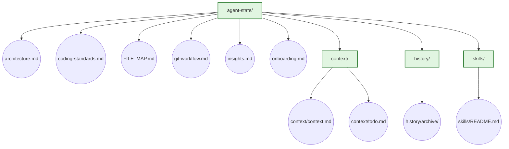
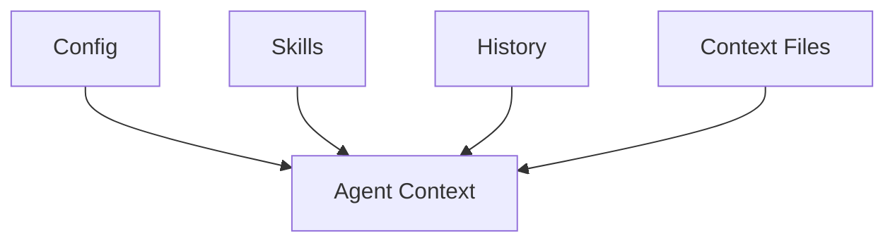

# Agent State Submodule — Work Credit RAG Platform

This submodule holds **all agent working files**: context, todo lists, session history, skills, coding standards, project architecture, and decision records.

It is versioned separately from source code so that:
- An agent can continue coding on any machine by cloning this submodule.
- Agent state does not pollute `git status` in the main source repos.
- The main repos stay clean and focused on production code.

## Why a submodule

Agent state changes independently of source code. Keeping it in a submodule means `git status` in `Work_Credit-RAG_Phase1`, `Work_RAG-KB`, etc. only shows source changes — not agent scratch files.

## Code hierarchy & file diagram

<details>
<summary>Expand to view file diagrams</summary>

### Variant A — Detailed Technical Diagram

Shows every agent-state working file with actual paths as node labels. Directories are boxes; files are circles.



### Variant B — High-Level Black Box Diagram

Minimal boxes: Agent Context, Context Files, History, Skills, Config. No file-level detail.



</details>

## Where to find everything

<details>
<summary>Expand to view file map</summary>

| What you need | Path (inside this submodule) |
|---|---|
| Agent mission & context | `context/context.md` |
| Agent todo list | `context/todo.md` |
| Archived sessions | `history/archive/` |
| Agent skills | `skills/` |
| Project architecture | `architecture.md` |
| Coding standards & rules | `coding-standards.md` |
| Key insights & decisions | `insights.md` |
| Git workflow & branch protection | `git-workflow.md` |
| File location map | `FILE_MAP.md` |
| Onboarding for new machine | `onboarding.md` |
</details>

## Repo & branch structure

| Branch | Purpose | Protection |
|---|---|---|
| `main` / `master` | Production — deployed code only | PR + code review required |
| `develop` | Integration / test — features merge here before release | PR + code review required |
| `feature/*` | Individual dev work | PR from feature → develop |

Never push directly to `main`/`master` or `develop`. Open a pull request and require at least one code review before merging. See `git-workflow.md`.

## Repo ownership (from AGENTS.md)

| Path | Repo | Branch | Owns |
|---|---|---|---|
| components/server-setup | Work_RAG-Server-Setup | main | hardware, model lifecycle, infra |
| components/knowledgebase | Work_RAG-KB | master | ingestion, retrieval, reranking (kb-manager) |
| components/guardrails | Work_RAG-Guardrails | main | policy, guarded Gemma |
| components/orchestrator | Work_RAG-Orchestrator | main | graph state, adapters, public API |
| components/tracing | parent (not a submodule) | main | fallback trace collector :3000 |
| parent root | Work_Credit-RAG_Phase1 | main | pins, integrated startup, E2E |
| agent-state/ | agent-state | main | this submodule — agent working files |

.gitmodules pins each submodule to an exact commit. Component fix → commit on the component's main, then advance the gitlink with a parent commit.

## Quick start on a new machine

<details>
<summary>Expand to view setup commands</summary>

```bash
git clone --recursive https://github.com/AliNikkhah2001/Work_Credit-RAG_Phase1.git
cd Work_Credit-RAG_Phase1
git submodule update --init --recursive
cat agent-state/onboarding.md
cat agent-state/architecture.md
cat agent-state/context/context.md
cat agent-state/context/todo.md
git branch --show-current
```
</details>

## Critical rules

1. Never force-push any repo.
2. Never commit secrets — `*.env`, tokens, passwords, `/tmp/opencode/langfuse.env`.
3. Never commit generated artifacts — `*.npz`, `__pycache__`, `*.log`, venvs.
4. Never run `pkill python` — use `bash deploy/vast/stop.sh` (port-scoped `fuser -k`).
5. Never set only one of `HF_HOME`/`HF_HUB_CACHE` — both must point to the same dir.
6. Never omit `request_id` in Studio run inputs.
7. Never commit directly to `main`/`master` or `develop` — use PR + code review.

## Libraries

No runtime libraries are installed from this submodule. It contains only markdown agent-working files. Dependencies for consuming repos are listed in each submodule's `pyproject.toml`.

## Changelog

| Version | Date | Summary |
|---|---|---|
| v1.0.0 | 2026-10-28 | Initial submodule split — agent context separated from production source code |
